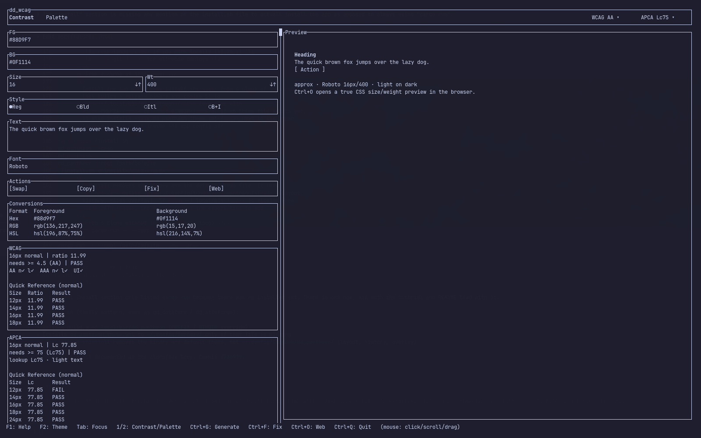

# dd_wcag

Terminal WCAG 2.x + APCA contrast checker and SCSS palette builder.

**[Illustrated tutorial](https://ldnddev.github.io/dd_wcag/)** — setup, install, Contrast, Fix, Palette, theming, and how to refresh the screenshots.



## Quick start

```bash
curl -fsSL https://raw.githubusercontent.com/ldnddev/dd_wcag/master/install.sh | bash
dd_wcag
```

The installer detects OS and CPU, downloads the matching GitHub Release package when one exists (Linux glibc x86_64/arm64, macOS Intel/Apple Silicon), and puts the binary in `~/.local/bin`. Alpine/musl and unpublished targets fall back to a cargo build. A default theme is copied to `~/.config/ldnddev/` only if that file is missing. On Linux it also writes `~/.local/share/applications/dd_wcag.desktop` so the app menu opens the TUI in a terminal. Pin a release with `--version`, or force a cargo build with `--from-source`:

```bash
curl -fsSL https://raw.githubusercontent.com/ldnddev/dd_wcag/master/install.sh | bash -s -- --version v0.5.0
curl -fsSL https://raw.githubusercontent.com/ldnddev/dd_wcag/master/install.sh | bash -s -- --from-source
```

From a local checkout (builds with cargo):

```bash
./install.sh
dd_wcag
```

Uninstall:

```bash
./install.sh -uninstall
# or, without a checkout:
curl -fsSL https://raw.githubusercontent.com/ldnddev/dd_wcag/master/install.sh | bash -s -- -uninstall
```

Developers can still run the TUI without installing:

```bash
cargo run
```

## What it does

- Check one foreground/background pair against **WCAG** (AA or AAA) and **APCA** (Lc45 / 60 / 75 / 90)
- Size 6–120px, weight 100–900, style chips, live conversions (hex / rgb / hsl)
- Fix pane nudges OKLab lightness toward a passing candidate
- Browser preview (`Ctrl+O`) at `/tmp/dd_wcag_preview.html` for true CSS pixel size
- Palette builder from Primary / Secondary / Tertiary (optional Support) → WCAG-gated `_palette.scss` and Penpot/Figma `_palette.tokens.json`
- Directed pair matrix of the five conceptual colors (text \\ surface); Enter or double-click a failing cell to Fix that pair

## Command line

No arguments opens the Contrast tab. Color flags open the TUI already filled in. `check` and `palette` print and exit, so they can run in a script.

```bash
dd_wcag --fg '#1C1E21' --bg '#F5F6F7'
dd_wcag --primary '#0B3D91' --secondary '#C45508' --tertiary '#1F7A4D' --generate

dd_wcag check --fg '#1C1E21' --bg '#FFFFFF' --json
dd_wcag check --pairs pairs.txt

dd_wcag palette --primary '#0B3D91' --secondary '#C45508' --tertiary '#1F7A4D' --out ./theme
```

`check` prints the WCAG ratio, AA and AAA, and APCA Lc. Exit 0 when the pair passes the selected WCAG level (default AA) and APCA bar (default Lc75). Exit 1 when it fails. Exit 2 when the arguments or a color are invalid. `--size` and `--weight` use the same large-text rule as the TUI. A pairs file is one `fg bg` pair per line.

`palette` writes `_palette.scss` and `_palette.tokens.json`. Primary, Secondary, and Tertiary are required. Support defaults to `#46BE8C`. Exit 1 when a blocking contrast check fails. The files are still written.

`dd_wcag --help` lists every flag. The full contract is SPEC.md §25.

## Everyday keys

| Key | Action |
|---|---|
| `1` / `2` | Contrast / Palette |
| `Tab` / `Shift+Tab` | Next / previous control |
| `Ctrl+G` | Generate palette |
| `Ctrl+F` | Toggle Fix |
| `Ctrl+O` | Open browser preview |
| `Ctrl+S` | Contrast: cycle style · Palette: save SCSS + Penpot/Figma tokens JSON |
| `Ctrl+C` | Contrast: copy hex · Palette: copy SCSS |
| `Ctrl+V` | Paste into the focused field (a valid color replaces the field) |
| `F1` / `F2` | Keys & mouse · Theme inspector |
| `Esc` | Blur / close popups (does not quit) |
| `Ctrl+Q` | Quit |

Theme lookup: `./dd_wcag_theme.yml`, then `~/.config/ldnddev/dd_wcag_theme.yml`, then built-in defaults (`version: 1` required).

## Docs

- [Tutorial](https://ldnddev.github.io/dd_wcag/) — user guide with screenshots (GitHub Pages)
- [SPEC.md](SPEC.md) — product spec
- [THEME_STRUCTURE_STANDARD.md](THEME_STRUCTURE_STANDARD.md) — shared ldnddev theme schema
